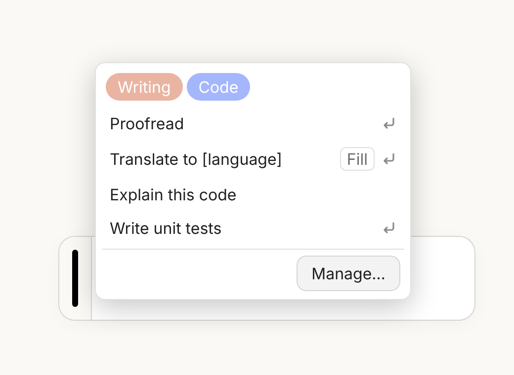
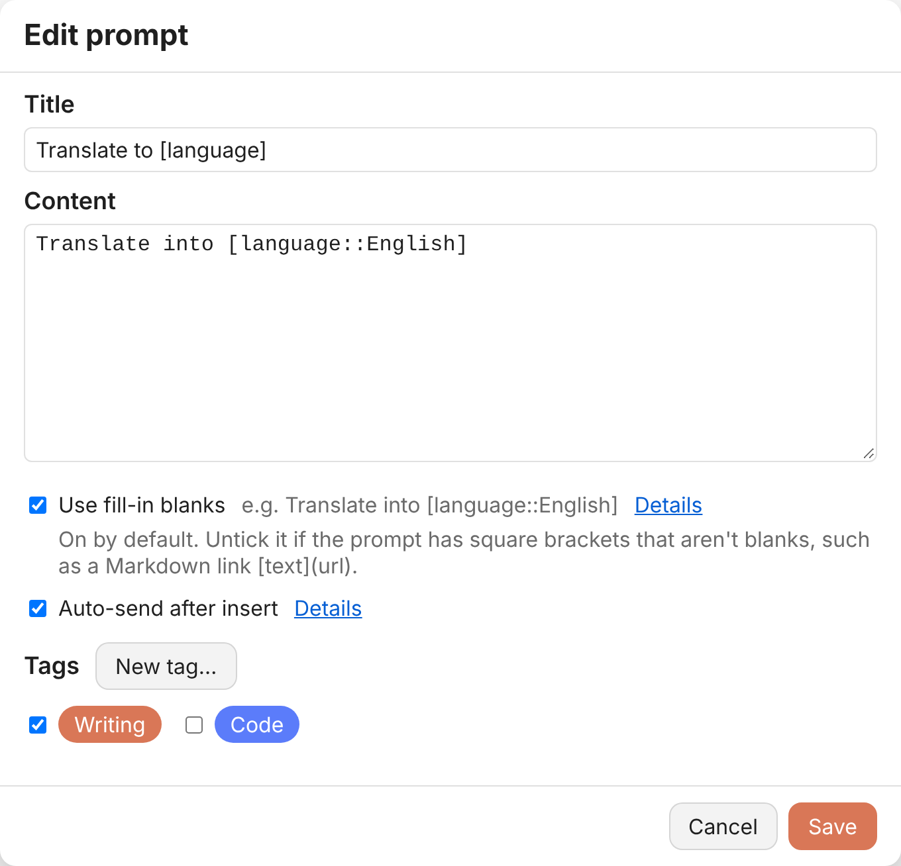
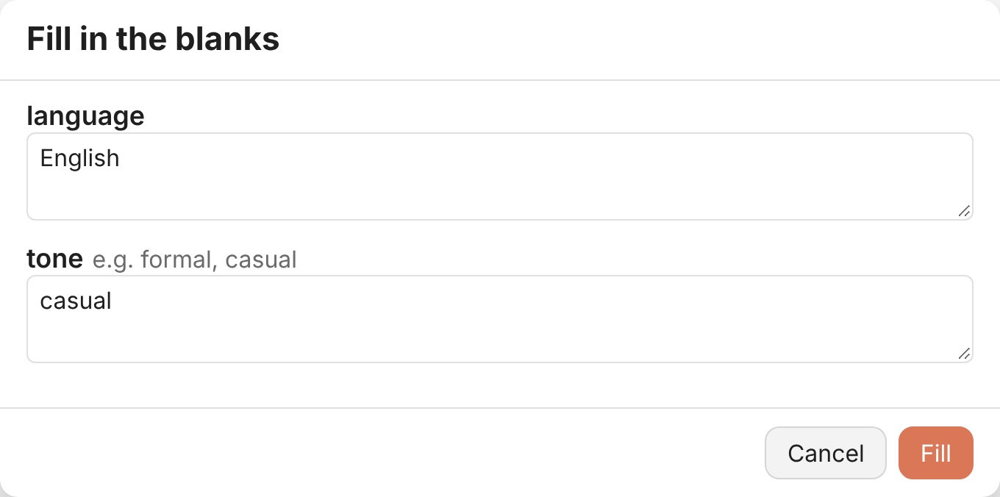
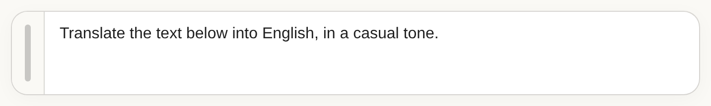

[切換中文](README.zh-TW.md)

# Prompt Popout

Keep the prompts you use all the time one hover away. Prompt Popout puts a slim handle next to the chat box on Claude, ChatGPT and Gemini. Hover over it to bring up your saved prompts, then click one to drop it into the chat box.



## Features

- **A handle by the chat box** — a narrow strip appears on the left of the chat box. When you hover over it or the list is open, it lights up in the site's own colour (orange on Claude, black on ChatGPT, blue on Gemini).
- **Pop-out list** — the list opens right next to the handle, level with your pointer. Hover to open it, or tap on a touch screen.
- **Fill-in blanks** — put `[blank]` in a prompt and you'll be asked what to put there before it's inserted, so you never have to hunt through the text to change a word. Turned on by default for new prompts.
- **Auto-send** — optionally hit send for you once the text is in.
- **Tags** — sort prompts with coloured tags and click a tag at the top of the list to show just those. Pick several and you'll only see prompts that have all of them.
- **Import / export** — back up your prompts, or move them to another computer, as a JSON file.
- **Built-in help** — *Details* links in the editor show, with examples, how fill-in blanks and auto-send work.
- The interface follows your browser's language: Traditional Chinese for Chinese, English for everything else.

## Install

1. Install [Tampermonkey](https://www.tampermonkey.net/).
2. Click here to install: [prompt_popout.user.js](https://raw.githubusercontent.com/bgtsai/prompt-popout/main/prompt_popout.user.js)

Tampermonkey will keep it up to date from then on.

## Usage

- Move your pointer onto the handle to the left of the chat box, then click a prompt to insert it.
- **Manage…** at the bottom of the list (or *Manage prompts* in the Tampermonkey menu) is where you add, edit, delete and reorder prompts, manage tags, and import or export.
- Need a new tag while editing a prompt? Click **New tag…**, create it, and it's ready to tick when you come back. Nothing you've typed is lost.



### How fill-in blanks work

When a prompt stays the same except for a few words (which language, what tone), write those words as blanks. Take this prompt:

```
Translate the text below into [language::English], in a [tone](e.g. formal, casual) tone.
```

1. Click it in the list and a fill-in window opens first, with one box per blank. *language* is already filled with English, and *tone* shows the hint "e.g. formal, casual".

   

2. Fill them in and click **Fill** (or press Ctrl+Enter, ⌘+Enter on a Mac). The chat box gets the finished sentence, with no brackets left:

   

Click **Cancel** or press Esc to insert nothing.

### Writing fill-in blanks

The fill-in window only appears for prompts with **Use fill-in blanks** ticked.

| Write | What you get |
|---|---|
| `[name]` | a blank called *name* |
| `[name::Bob]` | a blank that starts out filled with *Bob* (you can change it) |
| `[name](who to greet)` | a blank with the hint *who to greet* beside it |
| `[name::Bob](who to greet)` | both together |

If the same name appears more than once, you're asked once and every copy gets the same answer.

For example, with `Translate into [language::English], [tone] tone.` you're asked for *language* (already filled with English) and *tone*.

If a prompt has square brackets that aren't meant to be blanks, such as a Markdown link `[text](url)`, just untick **Use fill-in blanks** for that prompt.

## Bringing prompts over from another tool

If your old tool exported a JSON file where each prompt has `title`, `text`, `usePlaceholders`, `autoExecute` and `tags`, `tools/convert.html` turns it into a file Prompt Popout can import:

1. Download [convert.html](tools/convert.html) and open it in your browser. Everything happens on your computer; nothing is uploaded.
2. Choose your export file and click **Convert & download**.
3. In Prompt Popout, go to **Manage…** → **Import** and pick the file you just downloaded. Imported prompts are added after the ones you already have, and tags with the same name are reused.

## Notes

- Tested on simulated pages in Chromium, Firefox and WebKit. If a site update makes the handle disappear, please open an issue.
- Your data stays in Tampermonkey in your own browser and is never sent anywhere.

## License

[MIT](LICENSE)
