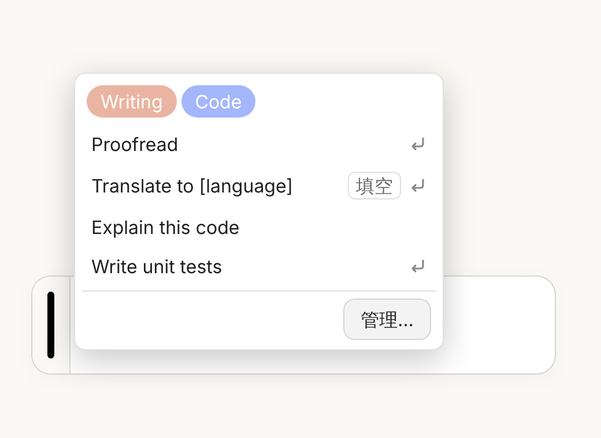
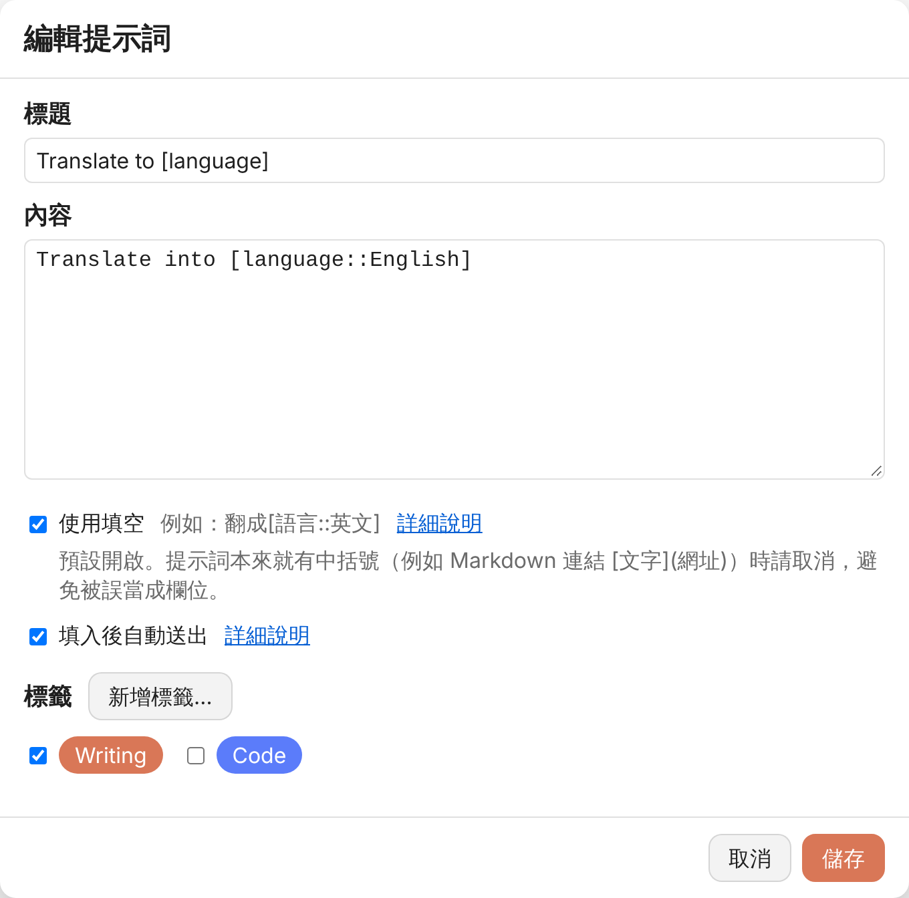
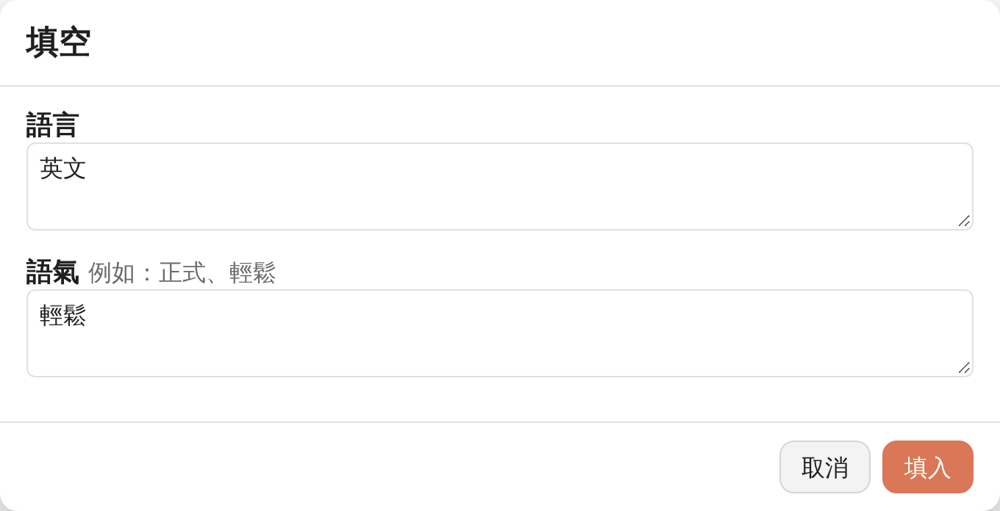
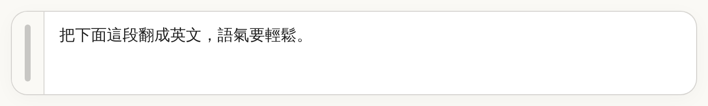

[Switch to English](README.md)

# Prompt Popout

常用的提示詞存起來，要用的時候不必再複製貼上。安裝後，Claude、ChatGPT、Gemini 的輸入框左邊會多一條把手，滑鼠移過去就跳出你的提示詞清單，點一下就填進輸入框。



## 功能

- **輸入框旁的把手**：輸入框左邊多出一小塊，中間一條細把手。滑鼠移上去或清單打開時，把手會換成該網站的主色（Claude 橘、ChatGPT 黑、Gemini 藍）。
- **跳出式清單**：清單出現在把手右邊，高度對齊你的滑鼠，滑過去就開；觸控裝置用點的也行。
- **填空**：提示詞裡寫 `[欄位]`，填入前會先跳出視窗讓你填，每次要換的字不用再自己找來改。新增的提示詞預設開啟。
- **自動送出**：填好後可以直接幫你按送出。
- **標籤**：用不同顏色的標籤分類，點清單上方的標籤就只顯示那一類；選多個時，只顯示全部都有的。
- **匯入／匯出**：用 JSON 檔備份，或搬到另一台電腦。
- **內建說明**：編輯頁有「詳細說明」，用例子告訴你填空和自動送出怎麼用。
- 介面語言跟著瀏覽器：中文就顯示繁體中文，其他都是英文。

## 安裝

1. 先安裝 [Tampermonkey](https://www.tampermonkey.net/)。
2. 點這裡安裝：[prompt_popout.user.js](https://raw.githubusercontent.com/bgtsai/prompt-popout/main/prompt_popout.user.js)

之後有新版本，Tampermonkey 會自動更新。

## 使用方式

- 滑鼠移到輸入框左邊的把手，清單就會出現，點一下提示詞就填進去。
- 清單最下面的「管理…」（或 Tampermonkey 選單裡的「管理提示詞」）可以新增、修改、刪除、排序提示詞，也能管理標籤、匯入和匯出。
- 編輯提示詞時想加新標籤，直接按「新增標籤…」，建好回來就能勾，正在寫的內容不會不見。



### 填空是怎麼運作的

同一段提示詞，每次只有幾個字要換（翻成哪種語言、用什麼語氣），就把那幾個字寫成空格。以這筆提示詞為例：

```
把下面這段翻成[語言::英文]，語氣要[語氣](例如：正式、輕鬆)。
```

1. 在清單點這筆提示詞，會先跳出填空視窗。每個空格一格：「語言」已先填好「英文」，「語氣」旁邊有提示「例如：正式、輕鬆」。

   

2. 填好按「填入」（或 Ctrl＋Enter，Mac 是 ⌘＋Enter）。輸入框拿到的是已經換好的句子，中括號都不見了：

   

按「取消」或 Esc，就什麼都不填。

### 填空怎麼寫

勾了「使用填空」的提示詞，才會跳出填空視窗。

| 寫法 | 效果 |
|---|---|
| `[名字]` | 一格叫「名字」的空格 |
| `[名字::小明]` | 預先填好「小明」，可以改 |
| `[名字](要稱呼誰)` | 旁邊多一行提示「要稱呼誰」 |
| `[名字::小明](要稱呼誰)` | 兩個一起用 |

同一個名字出現好幾次，只會問一次，每個地方都換成同樣的內容。

例如 `翻成[語言::英文]，語氣[語氣]。`：填入前會問「語言」（已先填好英文）和「語氣」兩格。

如果提示詞本身就有中括號、但不是要填的空格（像是 Markdown 連結 `[文字](網址)`），把那一筆的「使用填空」取消就好。

## 從其他工具搬過來

舊工具匯出的 JSON（每筆有 `title`、`text`、`usePlaceholders`、`autoExecute`、`tags` 欄位），可以用 `tools/convert.html` 轉成 Prompt Popout 能匯入的檔案：

1. 下載 [convert.html](tools/convert.html)，用瀏覽器打開。整個過程都在你的電腦上，不會上傳任何東西。
2. 選你的匯出檔，按「轉換並下載」。
3. 回到 Prompt Popout，「管理…」→「匯入」，選剛下載的檔案。匯入的提示詞會加在原本的後面，同名的標籤會直接沿用。

## 其他

- 已在 Chromium、Firefox、WebKit 用模擬頁面測試過。網站改版可能讓把手消失，遇到的話請開 issue 告訴我。
- 資料只存在你自己瀏覽器的 Tampermonkey 裡，不會傳到任何地方。

## 授權

[MIT](LICENSE)
